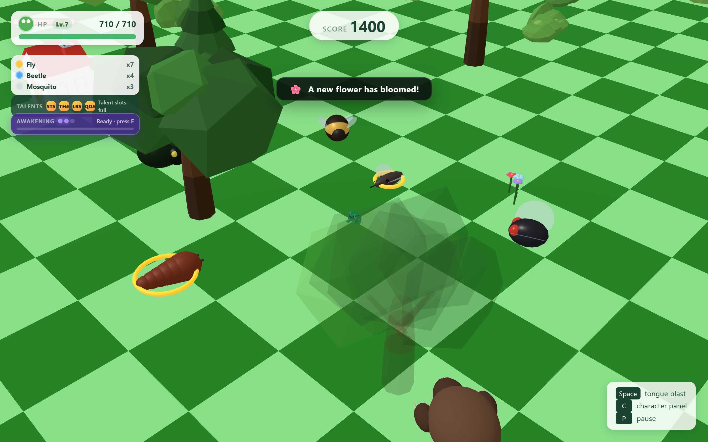
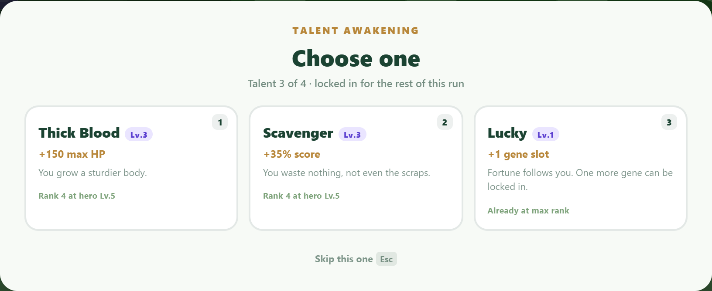
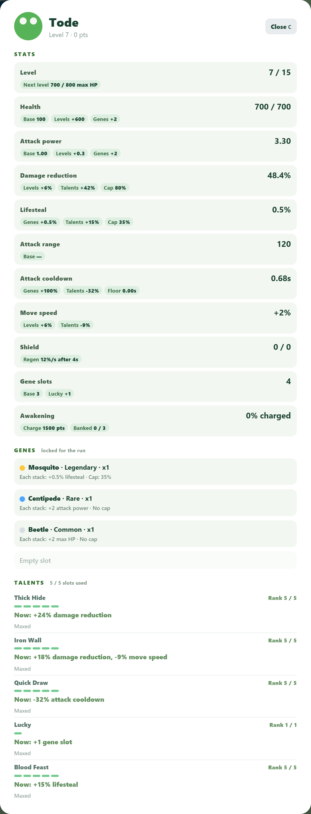

# Tode: Talent Awakening

**A frog. A meadow. An endless swarm.**

You are a frog with a tongue that never stops firing. Insects come from every direction,
you hold one key and everything in front of you dies — and every kill makes you a little
harder to kill. Then the game starts asking you to make choices.

A run lasts eight to fifteen minutes. You will not survive the first few.

> Submission for the **JetBrains Academy "Build Your Game Challenge"** — October 2026

### ▶ Play in your browser

## **[wudhx.github.io/tode-talent-awakening](https://wudhx.github.io/tode-talent-awakening/)**

No install, no download, no account. Runs in desktop Chrome, Edge, Firefox and Safari.

<a href="https://raw.githubusercontent.com/wudhx/tode-talent-awakening/main/docs/screenshots/gameplay.png"></a>

---

## How a run goes

**You start with 100 HP and nothing else.** No shop, no upgrade screen, no meta-progression
carried between runs. Everything you become, you become inside this run.

**1. You hop, and the tongue fires.** Arrow keys move; `Space` fires. Holding `Space` keeps
firing while you hop, so movement and damage are never in conflict — the only real decision
is *where you are standing* when the blast lands. The blast hits a circle around you, so
positioning is the whole skill.

**2. Every kill makes you permanently tougher.** Kills raise your maximum HP, and your
maximum HP is your level. There is no separate XP bar: the health bar *is* the progression
curve. Fifteen levels, each one paid for in insects.

**3. Every sixty seconds, pick one of three talents.** You have four talent slots, filled
across a run. Each talent keeps growing on its own as your level rises — a talent taken at
minute two is still getting stronger at minute twelve. That is why the draft matters more
than it looks: you are not picking a bonus, you are picking something that will scale.

**4. Genes drop from what you kill.** Pick one up and it locks into your build for the rest
of the run and stacks forever. Collect three of the same quality and they merge into the
next tier. Six species, three qualities — a reason to hunt one kind of insect instead of
whatever is closest.

**5. Then something enormous arrives.** Every few hundred points, a boss. A stag beetle
that charges in a straight line, a centipede that leaves the ground toxic behind it, a mole
that burrows and surfaces under your feet. Each one punishes a different habit, and none of
them can be answered the same way twice.

**6. You die, you see your score and your best run, and you go again.**

---

## The two things that make it a build game

**Nothing is stored that can disagree with itself.** Talent ranks are not saved anywhere —
they are derived from your hero level every time they are read. The panel, the draft cards
and the damage math all call the same function, so a talent cannot show one number and
apply another.

**Your build is the run.** There is no way to buy power before you start. A strong run is
one where you read the draft well and committed to a direction — and losing that build when
you die is the point, not a punishment.

---

## Screens

<table>
<tr>
<td width="50%"><a href="https://raw.githubusercontent.com/wudhx/tode-talent-awakening/main/docs/screenshots/talent-offer.png"></a><br><sub><b>The talent draft.</b> Three cards, one pick, every minute. Each shows the rank you would get right now and the hero level that buys the next one.</sub></td>
<td width="50%"><a href="https://raw.githubusercontent.com/wudhx/tode-talent-awakening/main/docs/screenshots/character-panel.png"></a><br><sub><b>The stat sheet.</b> Every number is shown with the sources that produced it — base, levels, genes, talents, bosses, awakening.</sub></td>
</tr>
</table>

---

## Where the course ended, and where this goes

The course build is a clean little loop: hop, blast, score, difficulty, one hit and you are
out. It is finished, and it is tiny.

Everything below was added on top of it, in roughly the order it appears in a run:

| | Course build | This |
|---|---|---|
| **Death** | One hit ends the run | 100 HP, and every kill raises the ceiling |
| **Progression** | Score goes up | 15 levels, each one earned by kills |
| **Build** | None | 16 talents drafted 4 at a time, ranks rising with your level |
| **Permanence** | None | 6 gene species × 3 qualities, locked in and merging 3-into-1 |
| **Power spike** | None | A 3-charge awakening you spend when it matters |
| **Threats** | One insect type | Six species, plus three bosses with their own mechanics |
| **Information** | A score | A stat sheet that names the source of every number |

---

## Systems

| System | What it does |
|---|---|
| **Hero levels** | 15 levels, 100 HP each. Kills raise max HP by 2.5, so the level curve *is* your health bar. |
| **Tongue blast** | Short-range area attack. Hold `Space` to keep firing — movement never interrupts it. |
| **Awakening** | Score feeds a bank of up to **3 charges** (1500 points each). `E` spends one: 3× attack, 65% less damage taken, wider reach, faster hops, for 10 seconds. |
| **Talents** | 16 talents, 4 slots, one offer every 60 seconds. Ranks are **driven by your hero level** (thresholds 1 / 2 / 3 / 5 / 7), so a talent you take at minute two keeps growing on its own. |
| **Genes** | 6 species × 3 qualities. Orbs drop from kills; picking one locks it for the run and stacks forever. Three of the same quality merge into the next tier. |
| **Bosses** | Every few hundred points a giant arrives, with a signature move: the stag beetle's horn charge, the centipede's lingering venom pools, the mole's burrow ambush. |
| **Dynamic difficulty** | Spawn rate, enemy speed, your cooldown and reach all scale with score. Enemies are tuned to scale slightly *faster* than you. |

---

## Controls

| Key | Action |
|---|---|
| `↑ ↓ ← →` | Hop |
| `Space` | Tongue blast (hold to keep firing) |
| `E` | Awakening — spends one banked charge |
| `1` `2` `3` | Pick a talent card |
| `Esc` | Decline the talent offer |
| `F` | Take the gene on the ground |
| `G` / `Esc` | Skip that gene |
| `C` | Character panel |
| `P` / `Esc` | Pause |
| `M` | Mute |

---

## Implementation notes

A few decisions that shaped the codebase:

**One source of truth per number.** Talent ranks are never stored. `talentEffectAt(talent,
rank)` computes an effect bag, and the panel, the offer cards and the combat math all call
it. A talent cannot display one value and apply another, because there is only one value.

**One damage pipeline.** Every hazard — insect contact, boss charge, venom tick, burrow
surfaced — goes through `hurtHero()`. Damage reduction, awakening mitigation, the pond's
20% soak and the shield are applied in one place, so a new hazard cannot quietly bypass
them.

**Collision without physics.** Rounded characters do not want axis-aligned boxes. Every
interaction is a minimum-distance test with its own tuned constant: enemy–enemy,
enemy–player, entity–obstacle.

**Insects that cannot get stuck.** When a body stops making progress it commits to one
tangent along the trunk and slides; if both tangents are blocked it flips; after 2.5
seconds of no progress it is moved to the nearest verified-clear spot. The board is also
generated with a minimum gap between trees, so the trap is rare in the first place.

**The whole thing is tested.** 179 Playwright checks run against the real build in a
headless browser — level curve, talent mapping, damage ceiling, boss abilities, shield
regeneration, collision, UI contracts, and a check that twelve insects spawned in a ring
all actually move.

---

## Project structure

```
game/
├── index.html
├── vite.config.js
├── public/
│   ├── models/            tode / enemy / small_house (GLB)
│   └── tode.svg
└── src/
    ├── main.js            scene assembly, game loop, UI wiring   (~3.1k lines)
    ├── style.css
    └── components/
        ├── Player.js        input queue + parabolic hop movement
        ├── Enemy.js         species table, boss profiles, signature abilities
        ├── Attack.js        tongue blast, cooldown, hit resolution
        ├── Health.js        HP pool, level derivation, heal-over-time
        ├── Score.js         scoring and top-of-screen readout
        ├── Difficulty.js    score-driven scaling for enemies and hero
        ├── Talents.js       talent pool, rank table, effect formatting
        ├── Genes.js         species/quality table, stacks, merging, drops
        ├── Awakening.js     charge bank and boost multipliers
        ├── PowerUp.js       pickups and their timed multipliers
        ├── Interactables.js hearts, fruit, flowers, bushes
        ├── Scenery.js       trees, bushes, ponds, flowers
        ├── House.js         destructible houses and their collision
        ├── Map.js           checkerboard board
        ├── Camera.js        follows the hero, keeps the world upright
        ├── Renderer.js      WebGL setup
        ├── Sound.js         WebAudio cues, no audio files
        └── HighScores.js    local best runs
```

Roughly 10,400 lines of JavaScript, no framework, no game engine.

---

## Run locally

```bash
cd game
npm install
npm run dev      # → http://localhost:5173
npm run build    # → game/dist
```

## Deployment

Pushing to `main` triggers a GitHub Actions workflow that builds the game and publishes it
to GitHub Pages.

---

## Attribution

### Course and base assets

- Course scaffold, task structure and `tode.glb` — **JetBrains Academy**,
  *Build a Game with an AI Coding Agent* ([course 30327](https://academy.jetbrains.com/course/30327)).
  The scaffold ships under the MIT license in [`LICENSE`](LICENSE).

### Third-party 3D assets

| Asset | Author | License | Source |
|---|---|---|---|
| `enemy.glb` — Armabee Evolved | Quaternius | Public Domain (CC0) | [Poly Pizza](https://poly.pizza/m/GcttdvsqsQ) |
| `small_house.glb` — Small House | Jarlan Perez | CC-BY 4.0 | [Poly Pizza](https://poly.pizza/m/053kskrV4U_) |

No other third-party art, fonts, music or sound recordings are used. Every sound in the
game is synthesised at runtime with the Web Audio API — there are no audio files in the
repository.

### AI tools used

| Tool | Used for |
|---|---|
| **JetBrains Junie** (in WebStorm) | The twelve course tasks: scene setup, hop movement, enemy spawning, collision, attack, scoring, difficulty scaling. |
| **WorkBuddy AI** | The expansion on top of the course build: hero levels and HP, the talent draft and its rank table, genes and merging, awakening charges, boss profiles and signature abilities, the HUD and character sheet, balance tuning, and the Playwright test suite. |

All requirements, design decisions, review and playtesting were done by the author; the
code was written in collaboration with these agents.

---

## License

MIT — see [`LICENSE`](LICENSE). The license text and copyright notice belong to the
course scaffold; the game code in `game/` is the author's work built on top of it.

